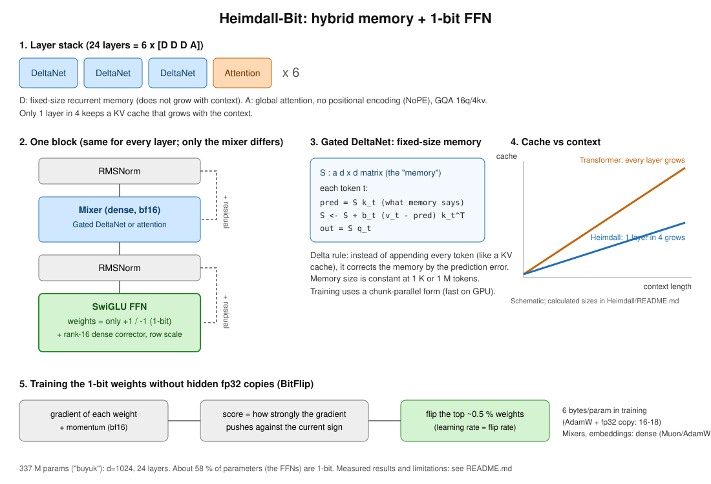

# Valerois AI — Heimdall

**Training small language models efficiently on a single consumer AMD GPU, with latent-free 1-bit feed-forward layers and a constant-memory hybrid architecture.**

Heimdall is a from-scratch research codebase (PyTorch, ROCm/CUDA) containing:

1. **A hybrid architecture** — 3 Gated DeltaNet layers (fixed-size recurrent memory) for every 1 global-attention layer, so the inference cache is ~12× smaller than a same-size Transformer's (by calculation).
2. **A latent-free 1-bit / 1.58-bit training engine** — binary (±1) or ternary weights are the *only* copy of the weights (no fp32 shadow weights, no Adam state); a custom optimizer (`BitFlip`) flips the strongest-gradient weights directly.
3. **Bifrost** — a method that converts a pretrained open Transformer (Llama/Qwen/SmolLM family) into a constant-memory model by training only ~2 % new parameters.
4. **Triton kernels** for int8 and packed 1/2-bit matrix products, and an **OpenAI-compatible inference server** (continuous batching, API keys, rate limits, Prometheus metrics; unit-tested, not load-tested).



Everything below was measured on one workstation: **AMD Radeon RX 9070 XT (16 GB, gfx1201) + Ryzen 7 7800X3D, Python 3.14.** Later results use ROCm 10.1.0 / PyTorch 2.14.0; the design study (§3) and the first small-scale comparison ran earlier on ROCm 6.4 / PyTorch 2.9.1 in eager mode. Unless stated otherwise, comparisons are single runs (one seed), so differences of ~0.03 nats or less should be treated as noise.

> **License:** source-available for review only (read, evaluate, and run unmodified to verify reported results); no usage rights are granted at this time. See [`LICENSE`](LICENSE).

---

## Key results

### 1. Training throughput on one 16 GB consumer GPU
| Model | Tokens | Speed | Memory | Wall-clock |
|---|---|---|---|---|
| Heimdall-Bit, 98 M params (binary FFN, `--arch bit --bits 1`) | 800 M | **47.4 K tok/s** (stable for the whole run) | 13.3 GB | 4.7 h, no crash |

`torch.compile` on the ROCm 10.1 / PyTorch 2.14 stack gave **2.9× faster training and 2.4× lower memory** than eager mode on a 5.8 M model (90 K → 264 K tok/s, 3.1 → 1.3 GB) with unchanged validation loss.

### 2. Latent-free low-bit training works, but its advantage fades with scale
Question tested: *can a model whose FFN weights are 1-bit match a dense model with half as many parameters?* (equal data, validation loss in nats/token, lower is better)

| Scale (bit model vs dense half-size) | Dense, N/2 params | Bit model, N params |
|---|---|---|
| 6 M vs 3 M (2 seeds) | 2.056 / 1.937 | **1.842 / 1.764** (ternary FFN), **1.840 / 1.752** (binary FFN) |
| 46 M vs 23 M (20 M tokens) | 1.646 / 1.635 | 1.651 / 1.656 |
| 98 M vs 52 M (40 M tokens) | **1.309** | 1.330 |

At small scale the bit model is clearly ahead; at ~50 M it ties; at ~100 M it is slightly behind (+0.02 nats). **We do not claim the target is met at scale.** Whether the gap closes with more data and larger models is the main open question (see *Proposed next steps*). Binary (±1) FFN weights were as good as ternary ones in these tests.

### 3. Design study: where to put the bits (6 M scale, 10 M tokens)
| Variant | Params | Val loss | vs dense |
|---|---|---|---|
| Dense | 5.8 M | 1.785 | — |
| All matrices ternary | 5.8 M | 2.093 | +0.308 |
| All matrices binary | 5.8 M | 2.128 | +0.343 |
| All ternary, 25 % wider | 8.0 M | 1.994 | +0.209 |
| All ternary + rank-16 dense corrector | 6.3 M | 1.997 | +0.212 |
| FFN-only ternary | 5.8 M | 1.916 | +0.131 |
| **FFN ternary + rank-16 corrector** (`--arch bit`) | 6.1 M | **1.842** | **+0.057** |

Most of the quality loss comes from binarizing the attention/DeltaNet projections; keeping those dense and adding a small dense low-rank corrector next to each bit matrix recovers most of it. In the final design **58 % of parameters are 1-bit** (FFN); the rest (mixers, embeddings) stay dense.

### 4. Bifrost: converting a pretrained Transformer to constant memory
SmolLM2-135M (30 layers), sliding window 64 + 4 attention-sink tokens + delta-rule memory, **0.8 M training tokens (~4 min on the GPU)**, WikiText perplexity at 2 K context:

| | Perplexity |
|---|---|
| Original (full attention) | 14.09 |
| Window only (no memory) | 25.76 |
| Converted, untrained | 26.70 |
| After layer-wise attention transfer | 22.43 |
| **After end-to-end distillation** | **17.61** |

About 70 % of the gap between "window only" and the original is closed with 0.8 M tokens, while the cache stays at 5.7 MB regardless of context length (the original needs 180 MB at 8 K tokens and ~22 GB at 1 M). It is **not** at parity (+25 % perplexity) and long-context retrieval quality has not been established. Our reimplementation of the teacher matches the Hugging Face `transformers` logits exactly (checked on SmolLM2-135M and Qwen3-0.6B). 4-bit teacher weights (`--q4`) cost +7 % perplexity on Qwen3-0.6B at 318 MB.

### 5. Kernels (layer-level micro-benchmarks, RX 9070 XT, ROCm 10.1)
Single-token decoding (M=1, 4096×4096): bf16 0.228 ms → **int8 Triton 0.081 ms (2.8×)**, packed 1-bit 0.090 ms (2.5×), packed 2-bit 0.083 ms (2.7×); relative error 0.8 % (int8) / 0.17 % (packed). For prefill/training shapes our kernels are *slower* than bf16 (0.33–0.72×), so training uses plain bf16. These are layer benchmarks, not end-to-end generation speed.

### 6. Toy recall task (MQAR, ~100 K params, 8 CPU-minutes, single seed)
Train gap ≤ 64 tokens, tested up to 16 K: attention-only 15.6 → 0.8 %, pure DeltaNet ~14.8 %, **hybrid 99.9 → 100 %**. Small and noisy, but consistent with the design rationale.

---

## What is *not* shown (honest limitations)
- **Scale:** the largest model trained from scratch is 98 M parameters on 0.8 B tokens. The sample outputs are syntactically plausible but semantically weak, as expected at this size. We have not yet compared against public models on standard benchmarks.
- The 1-bit advantage over a half-size dense model **does not persist** at ~100 M parameters in our tests.
- Training memory is not 1-bit: bit weights cost ~6 bytes/parameter during training (weight + gradient + momentum, all bf16) versus ~16–18 for AdamW with fp32 master weights.
- Only the FFN (58 % of parameters) is 1-bit, so inference memory is roughly on par with a half-size dense bf16 model (a calculation, not a measurement).
- Most comparisons use one seed; training data is 25 M – 0.8 B tokens (FineWeb-Edu, GitHub code, a small code set).
- Multi-GPU training, a production deployment record, and quantized serving of the full model are not implemented. Docker images are provided but were not built in CI.
- Code comments, CLI flag names and some log messages are in Turkish (glossary in [`Heimdall/README.md`](Heimdall/README.md)).

## Proposed next steps (plan, depends on compute)
1. **Scale study:** train the binary-FFN hybrid and a dense baseline at 300 M – 1 B parameters on ≥ 10 B tokens, several seeds, to learn whether the bit-vs-dense gap closes at scale.
2. Evaluate on standard benchmarks (`lm-eval-harness`) and long-context retrieval (passkey/RULER-style) for the scratch-trained and converted models.
3. Convert larger open models (Qwen3 1.7–8 B, 4-bit teacher) with Bifrost and measure long-context quality and serving cost.
4. Fused low-bit training kernels and end-to-end inference throughput measurements.

## Repository layout
| Path | Content |
|---|---|
| [`Heimdall/`](Heimdall/README.md) | The active project: model, training, low-bit engine, kernels, Bifrost conversion, server, benchmarks, tests |
| `04_TOKENIZERLAR/` | Tokenizers (default: `valerois_tokenizer_8k.json`, vocab 8192) |
| `stream_coder_100k.bin` | 25.6 M-token code corpus (uint16) used in the small-scale studies |
| `ESKI/` | Archive of earlier research (Bifrost CSL, Kuzgun, Valkir, Kuyu); superseded, kept for history |

## Quick start
```bash
git clone https://github.com/valeroisai/bifrost.git && cd bifrost/Heimdall
python3 -m venv .venv && source .venv/bin/activate
# AMD RX 9070 XT / ROCm 10.1 (the configuration we measured):
pip install --index-url https://stable.repo.amd.com/rocm/whl-next/ "torch[device-gfx1201]==2.14.0+rocm10.1.0"
# NVIDIA: pip install torch --index-url https://download.pytorch.org/whl/cu128   (code is device-agnostic; CUDA was not benchmarked by us)
pip install numpy tokenizers safetensors fastapi "uvicorn[standard]" pydantic huggingface_hub pyarrow httpx

python tests/test_heimdall.py && python tests/test_bifrost.py && python tests/test_bit.py && python tests/test_bitkernel.py   # 16 tests, CPU
python -m heimdall.train --preset temel --arch bit --bits 1 --data ../stream_coder_100k.bin --tokens 40e6 --out runs/demo
bash bench/hedef.sh orta        # reproduces the bit-vs-half-size-dense comparison (46 M vs 23 M)
```
See [`Heimdall/README.md`](Heimdall/README.md) for the architecture, all benchmark scripts, and the serving API.
